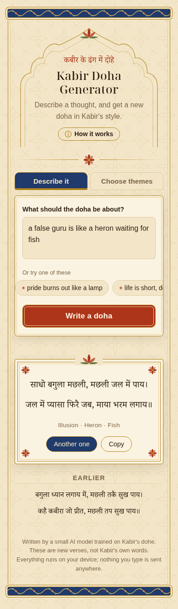
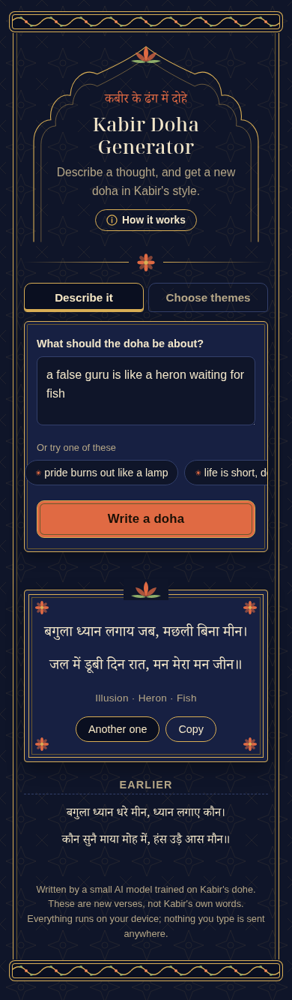

# Kabir Doha LLM

Write a thought in English, get back a new **doha** (दोहा, a two-line Hindi verse form) in the style of the 15th-century poet **Kabir**. It is done by two tiny models trained from scratch, and it runs entirely in the browser: no server, no API.

<p align="center">
  
  &nbsp;
  
</p>

```
"a false guru is like a heron waiting for fish"
        │  tag classifier (fastText-style, 1.7M params)
        ▼
  theme: maya   images: bagula (heron), machhli (fish)   style: random
        │  doha model (character-level GPT, 1.8M params)
        ▼
  बगुला ध्यान लगाय जब, मछली बिना मीन।
  जल में डूबी दिन रात, मन मेरा मन जीन॥
        │  matra checker: 13 + 11 beats per line, no copying of real Kabir
        ▼
  the best of up to 40 drafts is shown
```

This is a **learning project**: every model, tokenizer and checker here was written by hand and trained on a laptop. It makes no use of pretrained weights. The verses scan well more often than they make deep sense. Read them as a playful homage, not as Kabir's words.

---

## Repository layout

| Path | What it is |
|---|---|
| [`site/`](site/) | **The finished product.** A static website: two input modes, offline support, about 7.7 MB. Deploy as is. |
| [`dohamodel/`](dohamodel/) | The doha model: data pipeline, matra (meter) checker, transformer, lessons 1–8, training logs, export scripts. |
| [`clasifierLM/`](clasifierLM/) | The English → tags classifier: spec ([`buildclasifier.md`](clasifierLM/buildclasifier.md)), code, data, evaluation reports and [`NOTES.md`](clasifierLM/classifier/NOTES.md). |
| `index.html` | A local landing page that links the development pages (playground, full-loop comparison, classifier demo). |

---

## How the doha model was trained

### 1. Real data: about 2,000 of Kabir's dohe

- **Source.** *कबीर साखी संग्रह* (Belvedere Press, Allahabad), in two printings on archive.org:
  - the **1926** printing ([`in.ernet.dli.2015.342092`](https://archive.org/details/in.ernet.dli.2015.342092)) as the main text
  - the **1912** printing as a second OCR copy

  Both are public domain. We deliberately did **not** scrape Kavita Kosh, whose robots.txt says `ai-train=no`.
- **Extract and align.** [`data_prep/extract.py`](dohamodel/data_prep/extract.py) pulls the dohe out of each OCR text, along with the book's section (अंग) names. [`align.py`](dohamodel/data_prep/align.py) lines up the two printings doha by doha using sequence alignment, so every doha has two independent OCR readings.
- **Clean.** Claude Haiku compared both readings and wrote one corrected doha, with a confidence level and flags (fragment, not a doha, word replaced). The batches are in [`data/cleanup/`](dohamodel/data/cleanup/). A human spot check of a random sample against the scans came first.
- **Merge and split.** [`merge_clean.py`](dohamodel/data_prep/merge_clean.py) merges the batches, runs automatic checks and splits the set: **1,731 train / 306 val / 43 dropped** (report: [`data/clean/report.md`](dohamodel/data/clean/report.md)).

### 2. The meter checker (matra counting)

A doha has two lines, and a comma (the caesura) splits each line into **13 + 11 matras**. A matra is a beat: a short syllable counts 1, a long one counts 2. [`matra.py`](dohamodel/matra.py) counts them from Devanagari spelling. It handles vowel signs, consonant clusters that lengthen the syllable before them, anusvara and visarga.

The rules were tuned against real Kabir and against deliberately broken dohe ([`lessons/l6_matra.py`](dohamodel/lessons/l6_matra.py), [`l6b_tune.py`](dohamodel/lessons/l6b_tune.py)). Two rules make the checker accept the variable vowel lengths of old Hindi:
- a nasal rule
- a "flex" rule: words like है, में and के may count short

| Passes the checker | Exact (all four halves) | Exact or near (one half off by 1) |
|---|---|---|
| Real Kabir dohe | 61% | 86% |
| Broken dohe (a word deleted or repeated) | 3% | 8% |

A JavaScript port ([`web/matra.js`](dohamodel/web/matra.js)) agrees with the Python version on 3,880 of 3,880 test cases.

### 3. Synthetic data: 4,941 practice dohe

About 2,000 real dohe is too few to teach a model to follow tags, so we generated tagged practice dohe ([`data_prep/synth_gen.py`](dohamodel/data_prep/synth_gen.py)).

**Tags.**
- **10 themes:** ego, death, illusion, guru, devotion, empty ritual, speech, love, good company, patience
- **30 images:** lamp, potter, well, fish, heron, musk deer, …
- **4 styles ("devices"):** addressing "Sadho…", a rhetorical question, a "Kahe Kabir" signature line, a paradox

The tag ids are shared with the classifier ([`config/tags.yaml`](clasifierLM/classifier/config/tags.yaml)).

**Generator.** Waves of Claude Haiku agents, each with its own folder and 50–100 requests (one theme, 1–2 images and one style each). Every prompt shows real Kabir dohe and says what each image means in Kabir's work; for example, the heron stands for a hypocrite.

**Self-check loop.** Each agent runs [`meter_cli.py`](dohamodel/data_prep/meter_cli.py) on its own drafts and rewrites only the failures, for up to 3 rounds.

**Filter.** Every draft goes through format → meter (exact, or near: one half off by 1) → copy check (no run of 5 words from a real doha) → near-duplicate check (character 4-gram Jaccard ≥ 0.5).

**Result.** **4,941 kept** ([`data/synth/full/kept.jsonl`](dohamodel/data/synth/full/kept.jsonl)), about 58% of them an exact 13+11. Roughly balanced: 457–557 per theme, about 1,200 per style, 203–289 per image. Before scaling up, a pilot of 200 was reviewed by eye.

The real dohe were tagged too ([`tag_real.py`](dohamodel/data_prep/tag_real.py)):
- **themes** from the book's own sections
- **images** from Devanagari word lists
- **styles** from cue words

### 4. The model

[`model.py`](dohamodel/model.py) is a small **character-level GPT** written from scratch, following Karpathy's nanoGPT and built up step by step in lessons 1–4:

| | |
|---|---|
| Layers / heads / width | 4 / 4 / 192 |
| Context | 128 characters |
| Vocabulary | 109 tokens: 64 Devanagari characters and punctuation, a `|` separator, and 44 tag tokens |
| Parameters | 1.8M |
| Dropout | 0.15 |

Each training example is the tags followed by the doha:

```
<maya><rassi><kahekabir>|रस्सी देखी साँप सा, मूरख भरम न जाय।
माया ठगिनी जग ठगे, कबिरा सत्य न पाय॥
```

Each tag is a single token, and the loss ignores the tag positions: the model learns to write dohe *given* tags, not to predict tags.

### 5. Training ([`lessons/l8_train_tags.py`](dohamodel/lessons/l8_train_tags.py))

- **Stage 1.** AdamW, learning rate 1e-3 with a cosine schedule, batches of 64 × 128 characters, up to 7,000 steps with early stopping on validation loss (the best step was 2,600). **Every batch is half real, half synthetic**, so the 1,731 real dohe aren't drowned out.
- **Stage 2.** A short fine-tune on real dohe only, at learning rate ÷ 10, to pull the language back toward Kabir's own.
- **Time.** About 65 minutes on a laptop CPU (AMD Ryzen, no GPU). A 3.2M-parameter variant was trained on an AMD integrated GPU (ROCm, bfloat16).

### 6. Results: a data-scaling curve

All numbers come from 300 unfiltered samples per model. Validation loss is on the 306 held-out real dohe.

| Run | Synthetic dohe | Val loss | Uses requested image | Uses requested style | Meter exact / near | Copies real Kabir |
|---|---|---|---|---|---|---|
| Lesson 7 (real only, no tags) | 0 | 1.660 | – | – | 2% / – | 0% |
| tags_0 | 0 | 1.622 | 1% | 34% | 3% / 11% | 0% |
| tags_1k | 1,000 | 1.596 | 51% | 68% | 6% / 23% | 0% |
| tags_2500 | 2,500 | 1.585 | 69% | 69% | 8% / 18% | 0% |
| **tags_5k (shipped)** | **4,941** | **1.579** | **73%** | **73%** | **10% / 23%** | **0%** |
| tags_5k_3m (3.2M params) | 4,941 | 1.583 | 66% | 76% | 6% / 20% | 0% |
| tags_5k_3m_d25 (3.2M, dropout 0.25) | 4,941 | 1.588 | 72% | 68% | 9% / 23% | 0% |

**What we learned:**
- **Synthetic data mostly teaches *steering*.** Image use went from 1% to 73%. Validation loss improves only slowly and levels off around 1.58.
- **A bigger model did not help.** At 3.2M parameters the model memorized faster (train 0.63 vs val 1.77). More dropout narrowed that gap but did not beat the 1.8M model, by the numbers or by eye in a side-by-side comparison. The limit is the amount of real data, not model size.
- **Generate-and-filter does the rest.** About a third of raw samples scan, so the site keeps the best of a few drafts. That takes about 3 drafts on average and about 0.3 seconds on a laptop.

Training logs for every run are in [`dohamodel/lessons/`](dohamodel/lessons/).

## The tag classifier (English → tags)

Built in parallel from the spec in [`clasifierLM/buildclasifier.md`](clasifierLM/buildclasifier.md). The full log is in [`NOTES.md`](clasifierLM/classifier/NOTES.md); evaluation is in [`reports/`](clasifierLM/classifier/reports/).

- **Model.** A fastText-style bag of hashed word and character-trigram embeddings: 16,384 buckets × 100 dimensions, about 1.7M parameters. It has a softmax head for **101 themes** (100 plus "none") and a sigmoid head for **100 images**. No pretrained embeddings.
- **Data.** About 27,700 English requests written by a local Qwen 3.5 9B model (through LM Studio), deduplicated and filtered.
- **Test results.** Theme top-1 0.78, top-3 0.90; image micro-F1 0.91.
- **On the site.** The site keeps the most likely of the 10 themes the doha model knows, and images scoring ≥ 0.5 (at most 2).

---

## Using the output

### The website (`site/`)

There are two modes:
- **Describe it:** free English text goes through the classifier, which picks the tags.
- **Choose themes:** pick the theme, image and style from menus.

Under the hood:
- The doha model runs in a Web Worker.
- Weights ship as float16, which halves the download, and are widened to float32 in the browser.
- A service worker makes it work offline after the first visit, and it can be installed to a phone's home screen.

**Run it locally:**

```bash
cd site && python3 -m http.server 8000      # open http://localhost:8000
```

**Deploy to Cloudflare Pages** (or any static host). Set no build command and use `site` as the output directory, or run:

```bash
npx wrangler pages deploy site --project-name kabir-doha
```

`site/_headers` sets security headers, including a strict Content-Security-Policy, and cache rules. The page loads nothing from other origins.

### From JavaScript (Node or browser)

```js
import { readFile } from "node:fs/promises";
import { widen } from "./site/lib/load.js";
import { makeWriter } from "./site/lib/writer.js";

const meta = JSON.parse(await readFile("site/models/doha.json", "utf8"));
const buf = await readFile("site/models/doha.bin");
const writer = makeWriter(meta, widen(buf.buffer.slice(buf.byteOffset, buf.byteOffset + buf.byteLength)));

const best = writer.write({ theme: "vani", images: ["koyal"], device: "sadho" });
console.log(best.text);   // two lines, 13 + 11 matras, using the cuckoo image
```

- **Theme ids:** mrityu, ahankar, guru, bhakti, pakhand, vani, prem, satsang, dhairya, maya.
- **Image ids:** the first 30 images in `tags.yaml`.
- **Device (style) ids:** ulatbansi, sadho, prashn, kahekabir.

---

## Reproducing

```bash
cd dohamodel
python3 -m venv .venv && .venv/bin/pip install -r requirements.txt

# lessons 1–7 run on their own, e.g.
.venv/bin/python lessons/l7_train_real.py

# the shipped model (about an hour on CPU)
.venv/bin/python lessons/l8_train_tags.py --synth 5000 --name tags_5k

# export it and rebuild the site
.venv/bin/python export_tags.py tags_5k
.venv/bin/python build_site.py
cd .. && node dohamodel/site_check.mjs      # float16 parity + an end-to-end write
```

The checkpoints (`*.pt`), the exported experiment models (`dohamodel/web/models/`) and the per-agent working folders of the synthetic runs are not committed. They are large and can be regenerated. Everything the site needs is in `site/models/`.

## Limitations

- **Small vocabulary of ideas.** 10 themes and 30 images. The classifier knows 101 themes, but anything outside the 10 is mapped to the nearest of them.
- **Meaning drifts.** Many verses scan and use the right images but don't hold together as a thought.
- **Input must be English.** Hindi or Hinglish requests are not understood by the classifier.
- **Synthetic data.** About three quarters of the doha model's training dohe (and half of every training batch) were written by an AI model in Kabir's style, not by Kabir.

## Credits and licenses

- **Code, models and data written for this project:** [MIT](LICENSE).
- **Kabir's dohe:** public domain. Text from the Belvedere Press *कबीर साखी संग्रह* (1912 and 1926 printings), via archive.org.
- **Fonts:** Noto Serif Devanagari and Noto Serif Display, by Google, under the SIL Open Font License 1.1 (see [`site/fonts/LICENSE.txt`](site/fonts/LICENSE.txt)).
- **Model code:** follows Andrej Karpathy's [nanoGPT](https://github.com/karpathy/nanoGPT).
- **AI tools:** synthetic dohe and OCR cleanup by Claude Haiku; classifier requests by Qwen 3.5 9B; built with Claude Code.
